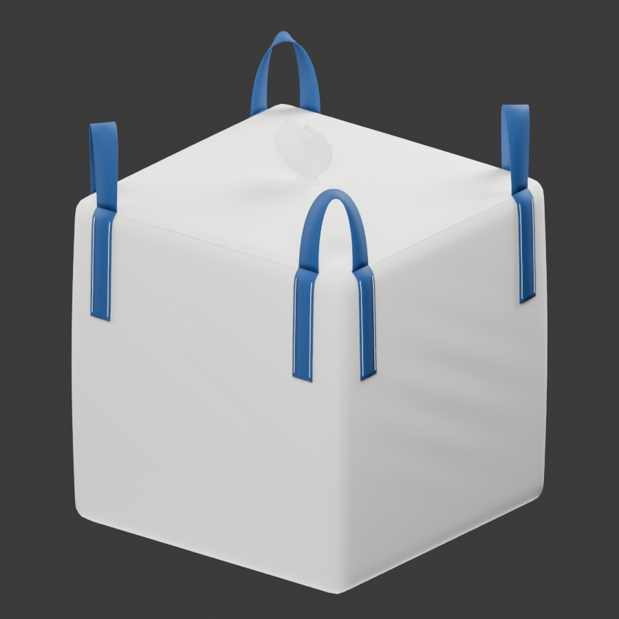

# Биг-бэг: доработанная версия

Подготовлена 18 ноября 2026 по запросу владельца. [Исходник](../../source/бигбег.glb) сохранён без изменений; его SHA-256 указан в отчёте.

## Файлы

- [bigbag-refined.glb](bigbag-refined.glb) — производная модель, 411 048 байт, 17 671 треугольник, один меш с тремя материалами.
- [bigbag-refined.blend](bigbag-refined.blend) — редактируемая сцена: отдельно корпус, горловина, стропы, петли и нити; освещение и камеры для проверки.
- [refine_bigbag.py](refine_bigbag.py) — воспроизводимая генерация в Blender 4.5 LTS.
- [verify_bigbag.py](verify_bigbag.py) — проверка зазора креплений и повторного импорта экспортированного GLB.
- [refinement-report.json](refinement-report.json), [verification-report.json](verification-report.json) — фактические результаты.

## Изменения

Корпус, дно и горловина белые, синими оставлены только подъёмные стропы и петли. Вместо неровной окраски используются отдельные детали с ровными краями. Вдоль строп проходят ровные белые линии нитей. Материалы матовые.

Для удаления дефектов пересобрана вся оболочка, горловина и крепления. Это более гладкая интерпретация исходной модели: прежние складки не сохранены. Материал без исходных текстур; микроплетение ткани не воспроизведено. Размер около одного метра, центр вращения расположен в центре модели. Экспорт объединён в один меш с тремя материалами; редактируемая сцена сохраняет отдельные детали.

## Проверка

Проверены виды спереди, сзади, сверху и снизу. Доставляемый GLB повторно импортирован и отрендерен: [спереди](verified-front.png), [снизу](verified-bottom.png). Материалы и координаты прочитаны корректно. У всех вершин восьми вертикальных креплений положительный зазор до оболочки; минимальный зазор около 1,22 мм. Это не проверка всех возможных пересечений между всеми деталями.

Поведение в браузере, FPS, физика, реакция на курсор и свайпы ещё не реализованы и не проверены. Требуется визуальное согласование владельцем. Эта доработка не завершает задачу T16.

